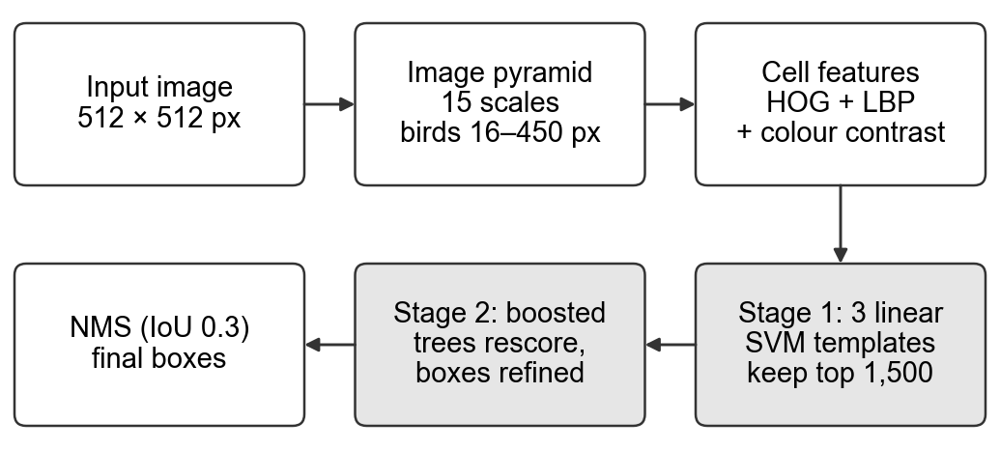
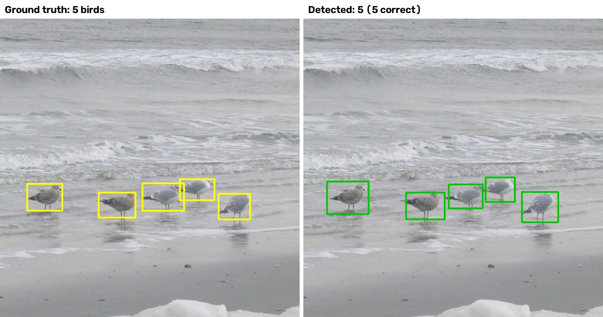
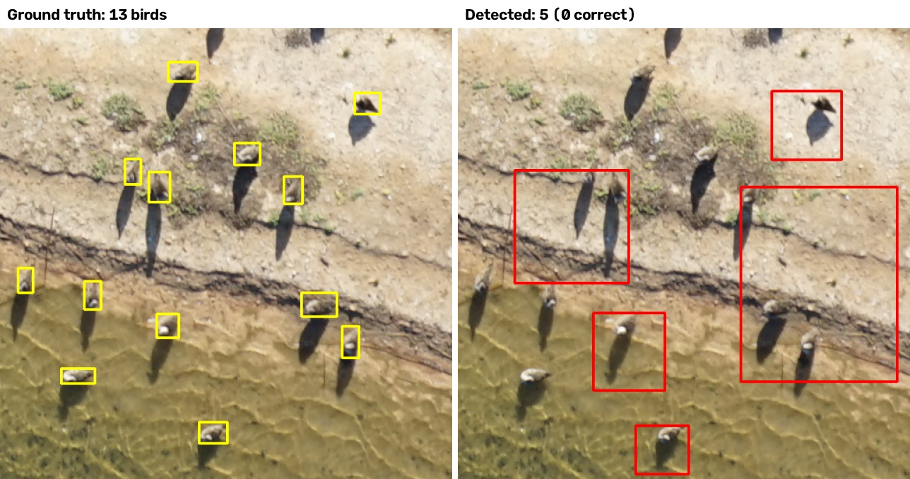

# Bird Detection with Handcrafted Features: HOG + LBP + Colour, SVM → Gradient-Boosted Trees

A classical (no deep learning, no pretrained weights) bird detector for the
[Beach Bird Detection Dataset v1.0](https://www.kaggle.com/datasets/liugalhigh/beach-bird).
A multi-scale sliding window is scored by fast linear SVM templates; the best windows are then
rescored by gradient-boosted trees. Everything runs on a CPU.

This is my part (Method B) of a UNSW COMP9517 *Computer Vision* group project (2026 T3, team SeeNN),
which compared four detectors on the same data: mathematical morphology, this handcrafted-feature
cascade, YOLO11n and Faster R-CNN.



## How it works

- **Features (47 channels per 4 × 4 px cell):** 31-channel HOG (Felzenszwalb variant), a 10-bin histogram of
  rotation-invariant uniform LBP(8,1), and 6 centre–surround CIE Luv colour channels. Features are computed
  once per pyramid level, so a window is just a crop of the feature map.
- **Search:** 3 templates (6×10, 8×8, 11×6 cells, from k-means on box aspect ratios) over a 15-level pyramid
  (step 2^(−1/3)), covering birds of roughly 16–450 px. The top 1,500 windows per image become proposals.
- **First stage:** L2-regularised squared-hinge linear SVMs, solved in the primal with a custom
  **L-BFGS solver (SciPy)** – `LinearSVC` would have needed about 16 GB of memory here. Trained with
  **3 rounds of hard-negative mining**.
- **Second stage:** a `HistGradientBoostingClassifier` per template rescores each window from its full
  ~4,500–4,900-dimensional feature vector.
- **Boxes and scores:** ridge box regression (R-CNN style), per-template logistic calibration so scores are
  comparable across templates, then NMS.

Templates, regressors and trees use the training split only; the validation split is used for calibration,
NMS tuning and model selection; the test split was used once, on the final model.

## Results

Ablation on the validation split ([full table](results/validation_summary.md)):

| Configuration | mAP@0.5 | Best F1 |
|---|---:|---:|
| HOG | 0.203 | 0.296 |
| HOG + LBP | 0.305 | 0.373 |
| HOG + colour | 0.304 | 0.379 |
| HOG + LBP + colour | 0.352 | 0.434 |
| + random-forest rescoring | 0.427 | 0.474 |
| **+ gradient-boosted rescoring (final)** | **0.466** | **0.523** |

Final model on the 240-image **test** split: **mAP@0.5 0.394**; at the validation-selected threshold
F1 0.449 (P 0.533, R 0.387) and mean count error 3.69 birds per image, at about 0.9 s per image on one CPU core.
AP falls as scenes get more crowded: 0.618 for 1–5 birds, 0.402 for 6–20, 0.340 for 21–50.

For comparison, the team's morphology baseline reached 0.020 test mAP@0.5 and Faster R-CNN 0.899.
The full comparison, including robustness and limited-label studies, is in the [team report](report/team_report.pdf).

| Success (all 5 birds found) | Failure (long shadows) |
|---|---|
|  |  |

## Running it

Developed with Python 3.13 on an Apple M4 CPU; no GPU needed, 16 GB RAM recommended.

```bash
pip install -r requirements.txt
export DATA="/path/to/Beach Bird Detection Dataset v1.0"   # folder with images/, labels/, dataset_manifest.csv
cd src

# 1. linear templates with hard-negative mining (~35 min); --keep-pool saves the window pool for stage 2
python train.py --data "$DATA" --name c1e3 --features hog+lbp+color --C 1e-3 --keep-pool

# 2. gradient-boosted rescoring (~30 min), then evaluate on validation
python train_reranker.py --run runs/c1e3 --data "$DATA" --kind gbdt
python evaluate.py --run runs/c1e3_gbdt --data "$DATA"

# success / failure examples, or detect birds in your own photos
python visualize.py --run runs/c1e3_gbdt --data "$DATA" --split val
python demo.py --run runs/c1e3_gbdt --image photo.jpg
```

`./run_experiments.sh "$DATA" runs` reproduces every experiment in the table (about 4 hours), and
`python summarize_runs.py --runs runs --split val` builds the summary.

| File | Purpose |
|---|---|
| `features.py` | HOG, LBP and centre–surround colour features |
| `detector.py` | image pyramid, template scoring, box regression, rescoring |
| `train.py` | linear templates: hard-negative mining, box regression, calibration, NMS tuning |
| `train_reranker.py` | second-stage random forest or gradient-boosted trees |
| `metrics.py` / `evaluate.py` | mAP@0.5, best F1, count error, results by density and size |
| `visualize.py` / `demo.py` | drawn detections for dataset images or any photo |
| `common.py` | dataset loading, IoU, NMS, COCO-format export |

## Known limitations

- Five mining rounds collapsed after the negative pool hit its 80k cap; the final model uses three. The cause was not found.
- Validation results are optimistic, since calibration and model selection used the validation split.
- Fixed templates and 4 px cells limit localisation; shadows, rocks and shells cause most false positives.

## References

Dalal & Triggs (2005) HOG · Felzenszwalb et al. (2010) part-based models and hard-negative mining ·
Ojala et al. (2002) LBP · Girshick et al. (2014) box regression · Friedman (2001) gradient boosting ·
Liu & Nocedal (1989) L-BFGS · Platt (1999) calibration.
